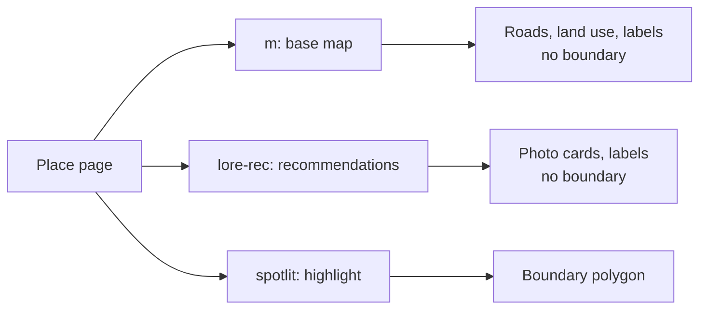

# Findings

Observed on 2026-11-11, mostly on Indiranagar, Bengaluru (`0x3bae16a418770391:0xb50f46b826501036`).

## Where the boundary is, and where it is not

A place page loads several tile layers. Only one holds the boundary.

| layer | what it holds | boundary geometry |
|---|---|---|
| `m` | Base map: roads as lines, land use as areas, labels. | No |
| `lore-rec` | Recommended places with photo links, and labels. Its request URL carries the feature id. | No |
| `psm` | Requested together with `spotlit`. | Not needed |
| `spotlit` | A mask outside the place and a fill inside it. | Yes |

Two things point at the wrong layer:

- The `lore-rec` request is the one that carries the feature id as `0x...:0x...` text. The `spotlit` request carries it as two decimals, so a text search of the network log for the hex id misses it.
- The place label in the `m` layer carries the feature id too, as two fixed64 values. The label is a point, not the outline.

## Accuracy

| measure | value |
|---|---|
| Coordinate step at zoom 17, latitude 13 | 0.073 m |
| Bounds of the zoom 17 polygon against the viewport box Google requests for the place | within 0.000002 degrees, about 0.2 m |
| Largest gap between the zoom 15 outline and the zoom 17 outline | 0.73 m |
| Area at zoom 15 and at zoom 17 | 3.058 km2 at both |
| Vertices | 140 at zoom 15, 214 at zoom 17 |

A lower zoom gives the same outline with fewer vertices. Google simplifies the line per zoom. It does not move it.

## Zoom and request count

| place | automatic zoom | geometry | requests | sync time |
|---|---|---|---|---|
| Indiranagar, Bengaluru | 17 | Polygon | 94 | 25 s |
| 560038 | 17 | Polygon | 152 | 33 s |
| Manhattan, New York | 15 | MultiPolygon | 199 | 47 s |
| Bengaluru | 14 | MultiPolygon | 240 | 54 s |

These use the default `max_tiles=500`. The sync client pauses 0.1 s after each request. `AsyncBoundaryClient(concurrency=8)` fetched Koramangala at zoom 17 in 5.9 s.

## Places without a boundary

Google draws a boundary for areas: localities, cities, postal codes, boroughs. It draws none for a shop, a restaurant or a road. For those, no tile anywhere carries a mask. The probe step finds this with one tile request and raises `NoBoundaryError`.

An invalid feature id behaves the same way.

## Things that look like bugs and are not

- **An inside tile is empty.** For a locality, a tile fully inside the place has no area layer. A decoder that only reads fills leaves a hole in the middle of the polygon. Reading the place as "tile minus mask" avoids this.
- **A postal code inside tile has a fill and no mask.** The same position, a different shape of tile. Both mean "inside".
- **Mask and fill differ slightly.** A few hundred square units per tile, from separate rounding.
- **A place can be several pieces.** Koramangala, Manhattan and Bengaluru come back as `MultiPolygon`.

## Capturing responses

Tile responses declare `charset=x-user-defined`. A tool that saves the body as text maps each byte from 0x80 to 0xFF to the code point U+F780 to U+F7FF. To get the bytes back, subtract 0xF700 from those code points.

A text-mode file read can also translate `\r` to `\n` and corrupt the body. Read captured bodies with newline translation off.

## Preview basemap

- Google raster road tiles come from `https://mt1.google.com/vt/lyrs=m&x={x}&y={y}&z={zoom}`. `scale=2` returns 512-pixel tiles. The request needs no key.
- `tile.openstreetmap.org` answers HTTP 403 "Access blocked" to a client that does not identify its application in the User-Agent. The preview sends `gmaps-boundary/<version> (+project URL)`.
- CARTO basemap tiles now need an API key. Without one they return a watermark tile.

## Known limits

- **Far pieces.** The coarse pass starts from a 3 by 3 block of zoom 12 tiles around the label point and walks through tiles that touch each other. A piece of the place outside that block, and not connected to the rest by touching tiles, is missed.
- **Antimeridian.** A place that crosses 180 degrees longitude is not handled.
- **Ambiguous names.** See [Search format](search-format.md).
- **Undocumented formats.** Google can change either format at any time. See [Investigating a format change](investigating-format-changes.md).
