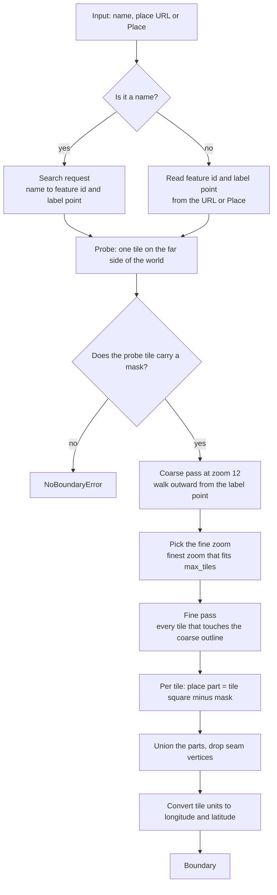
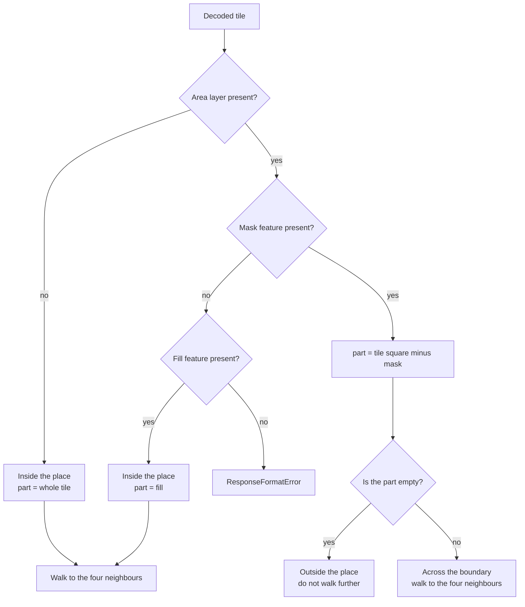
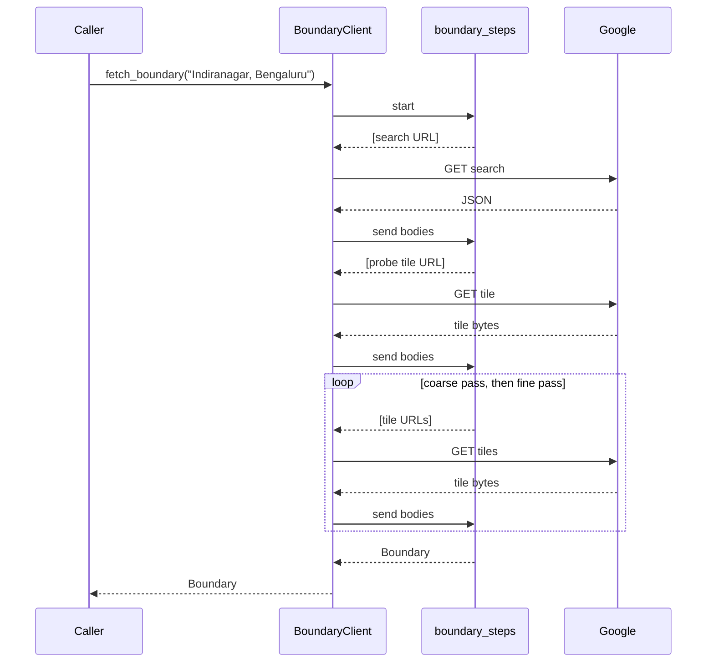

# How it works

Observed on 2026-11-11.

Google Maps outlines a searched area with a red dotted line. The map does not download that line as a polygon. It downloads vector tiles, and each tile carries the piece of the outline that falls inside it. This library fetches the same tiles and joins the pieces.

## The request plan

For Indiranagar the plan makes 94 requests: 1 search, 1 probe, 10 coarse tiles and 82 fine tiles. Of the fine tiles, 30 are outside the place, 34 are across the boundary and 18 are inside.

## Why each step exists

**Search.** A tile request needs the place's feature id, the `0x...:0x...` pair in a Google Maps place URL. It also needs a starting point on the map. The search response gives both. See [Search format](search-format.md).

**Probe.** A tile inside a place and a tile for a place without a boundary look the same: neither has a mask. One tile cannot tell the two cases apart. A tile on the far side of the world can. It is outside any real place, so it carries a full mask when the place has a boundary and no mask when it has none.

**Coarse pass.** The label point is where Google puts the place name. It is usually inside the polygon, but not always. A zoom 12 tile is about 10 km wide, so a 3 by 3 block around the label point reaches the polygon. The coarse outline then tells the fine pass which tiles to fetch, and how many tiles each zoom needs.

**Fine pass.** The fine pass fetches every tile that touches the coarse outline, plus a margin of half a tile. It also keeps walking outward from any tile that holds part of the place, so an error in the coarse outline cannot cut the result short.

**Mask subtraction.** Every tile outside or across the boundary carries a mask polygon that dims the map outside the place. The place part is the tile square minus the mask. Tiles across the boundary also carry the place fill. The library compares the two and raises `ResponseFormatError` when they differ by more than 1% of the tile. See [Tile format](tile-format.md).

## How a tile is classified

## One code path for sync and async

The plan lives in `_steps.py` as generators that do no I/O. A generator yields a batch of URLs, receives the response bodies, and returns its value at the end. `BoundaryClient` runs each batch one request at a time. `AsyncBoundaryClient` runs each batch concurrently.

## Module map

| module | job |
|---|---|
| `_protobuf.py` | Decode protobuf wire format without a schema. |
| `_tiles.py` | Tile addresses, tile URLs, and decoding a tile into a place part. |
| `_places.py` | `Place`, place URL parsing, search response parsing. |
| `_steps.py` | The request plan, as generators without I/O. |
| `client.py` | Sync and async clients: HTTP, retries, pacing. |
| `preview.py` | PNG preview over Google Maps or OpenStreetMap tiles. |
| `cli.py` | The `gmaps-boundary` command. |
