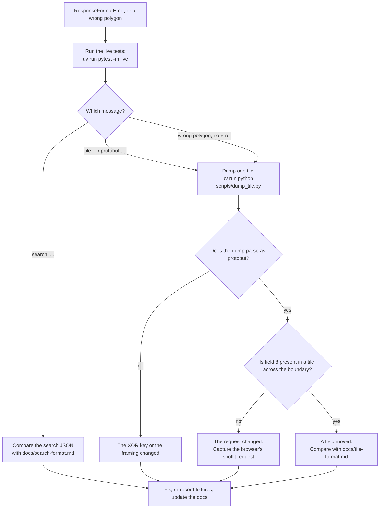

# Investigating a format change

Google does not document the endpoints this library reads. When one changes, the library raises `ResponseFormatError` instead of returning a wrong polygon.

## If you hit this as a user

[Open an issue](https://github.com/kujjwal02/gmaps-boundary/issues/new?template=format-change.yml) with:

1. The library version: `python -c "import gmaps_boundary; print(gmaps_boundary.__version__)"`.
2. The query, the zoom, and the full error message.
3. The date, and the country you ran it from.

Also open an issue when the library returns a polygon that does not match the red dotted line on Google Maps. That is a format change the checks did not catch.

## Finding what changed



### Dump a tile

```bash
uv run python scripts/dump_tile.py "Indiranagar, Bengaluru" 15 23450 15191
```

This prints the decoded tile as a field tree, and the vertices of each area feature. Tile `15/23450/15191` lies across the north edge of Indiranagar. A healthy dump shows field 8 with two features, one of them with field 40154408.

### Capture what the browser sends

1. Open Google Maps, open the developer tools, and select the Network tab.
2. Search for the place and wait for the red dotted line.
3. Filter the requests by `spotlit`.
4. Copy the request URL. Compare its `pb=` value with the request in [Tile format](tile-format.md).

The browser batches tiles through `/maps/vt/stream/`. The single-tile endpoint `/maps/vt/pb=` takes the same parameters after the tile address.

To find which response holds a boundary when the layer name itself has changed, look for small responses. A spotlit tile is 40 to 600 bytes. Base map tiles and recommendation tiles are several kilobytes.

### After the fix

```bash
uv run python tests/record_fixtures.py   # re-record the replayed responses
uv run pytest                            # offline suite
uv run pytest -m live                    # against Google
```

Then update the page in `docs/` that describes the changed format, with the new observation date.
