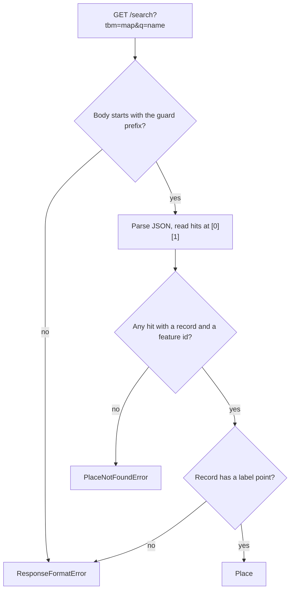

# Search format

Observed on 2026-11-11.

The library resolves a place name with one request.

## Request

```
GET https://www.google.com/search?tbm=map&hl={language}&gl={region}&q={name}
```

The request needs no cookie. It answered both a browser User-Agent and the default httpx one.

## Response

The body is JSON behind a guard prefix:

```
)]}'
[["Indiranagar, Bengaluru", [[..., [record]]], ...], ...]
```

Everything is positional arrays. Paths below are zero-based indexes from the top of the JSON.

| path | meaning |
|---|---|
| `[0][0]` | The query text. |
| `[0][1]` | The list of hits. |
| `[0][1][i][14]` | The place record of hit `i`. Absent for a hit that is not a single place. |
| `record[9][2]`, `record[9][3]` | Latitude and longitude of the label point. |
| `record[10]` | Feature id, `0x...:0x...`. |
| `record[11]` | Name. |
| `record[18]` | Name with locality and region. |
| `record[78]` | Places API place id, `ChIJ...`. Not used. |
| `record[89]` | Knowledge graph id, `/m/...`. Not used. |

The library takes the first hit that has a feature id.



## How names resolve

| query | outcome |
|---|---|
| `Indiranagar, Bengaluru` | One hit with a record. Resolves. |
| `560038` | Resolves to the postal code area. |
| `asdfghjkl qwertyuiop` | One hit with no record. `PlaceNotFoundError`. |
| `cafes in Indiranagar` | A category search. No hit has a record. `PlaceNotFoundError`. |
| `Springfield` | Resolves to Google's top pick. Observed: a historic site, not a city. |
| `Gandhi Nagar` | Resolves to Gandhinagar, Gujarat. Many localities share the name. |

Google ranks hits by the region of the caller's IP address. An ambiguous name can resolve differently from another country. Qualify the name with a city, state or country.

## Other shapes of the same endpoint

- The browser sends a long `pb` parameter with the search. With that parameter the response is `application/octet-stream` in a binary encoding. This library does not send it and does not decode that encoding.
- With `tch=1` the response is a JSON object that wraps the same payload as a string in its `d` key.
- `GET /s?tbm=map&suggest=p&q=...` is the autocomplete endpoint. Its response also carries feature ids. This library does not use it.
