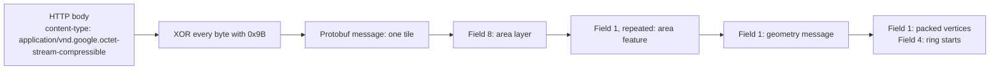
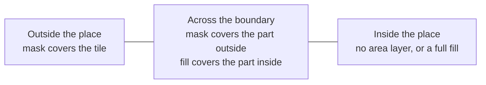

# Tile format

Observed on 2026-11-11. Field meanings come from reading responses, not from a schema. Fields marked "unknown" are present but their meaning is not established.

## Feature id

A Google Maps place URL carries the feature id after `!1s`:

```
.../maps/place/Indiranagar.../data=...!1s0x3bae16a418770391:0xb50f46b826501036!8m2!3d12.9783692!4d77.6408356...
```

- `0x3bae16a418770391` is the first half. In decimal: `4300399588226302865`.
- `0xb50f46b826501036` is the second half. In decimal: `13046724402246324278`.
- `!3d` and `!4d` are the latitude and longitude of the label point.

The tile request takes both halves in decimal.

## Request

```
GET https://www.google.com/maps/vt/pb=
  !1m4!1m3!1i{zoom}!2i{x}!3i{y}          tile address
  !2m2!1e2!2sspotlit                     layer: spotlit
  !3m8!2s{language}!3s{region}!5e1105!12m4!1e68!2m2!1sset!2sRoadmap!4e1
  !5m4!1e4!8m2!1e0!1e1!6m11!1e12!2i2!19m1!1e0!20m1!1e0!39b1!44e1!50e0!67m1!1e1
  !27m6!299174093m5!14m4!1m3!1m2!1y{first half}!2y{second half}!8b1
```

The path is one line. It is split here for reading.

- The request needs no cookie and no API key.
- It answered both a browser User-Agent and the default httpx one.
- `!8b1` is required. Without it the response is a 54-byte tile with no area layer.
- The browser sends more inside the `!27m` block: the place type (`gcid:sublocality1`), a viewport box, the label point and a knowledge graph id. None of them is needed for the geometry.
- The browser also asks for a `psm` layer in the same request. It is not needed.
- Tile addresses are standard Web Mercator `zoom/x/y`.

The browser fetches tiles in batches through `/maps/vt/stream/pb=...`. That response starts with the bytes `XHR1`, followed by one chunk per tile. A chunk is a 4-byte big-endian length, a 2-byte little-endian chunk index, and the tile body. The length counts the index and the body. This library uses the single-tile endpoint, which returns one tile body with no framing.

## Response encoding



The body is a protobuf message with every byte XORed with `0x9B`. A decoded tile starts with `0a 09 08 0f 10 ...`: field 1, the tile address.

## Tile message

| field | type | meaning |
|---|---|---|
| 1 | message | Tile address: `1` zoom, `2` x, `3` y. |
| 2 | message | Unknown. Observed `{1: 3, 2: 1}`. |
| 7 | message | Line layer. Present in base map tiles, absent in spotlit tiles. |
| 8 | message | Area layer. Holds the mask and the fill. |
| 10 | message | Label layer. |
| 13 | bytes | Unknown. |
| 14 | varint | Unknown. Observed 0 in tiles with no content. |
| 16 | varint | Unknown. Observed 803. |
| 19 | message, repeated | Unknown. |
| 28, 29 | varint | Unknown. |

## Area feature

Field 8 holds repeated area features in its field 1.

| field | type | meaning |
|---|---|---|
| 1 | message | Geometry. |
| 2 | varint | Unknown. Observed 1. |
| 4 | varint | Unknown. Observed 10000. |
| 5 | fixed32 | Unknown. |
| 8 | varint | Style id. Observed 6017 for the mask, 14012 for a locality fill, 18422 for a postal code fill. |
| 40154408 | bytes | Extension. Present on the mask only. |

The library tells mask from fill by the extension field, not by the style id, because the fill style differs by place type.

## Geometry

| field | type | meaning |
|---|---|---|
| 1 | packed varints | Vertices: zigzag-encoded `dx, dy` pairs. |
| 2 | packed varints | Triangle list: vertex indices, three per triangle. |
| 3 | packed varints | Indices of edges that lie on the tile border. The map does not stroke them. |
| 4 | packed varints | Index of the first vertex of each ring after the first. |
| 6 | varint | Unknown. |

- A tile side is 4096 units. `(0, 0)` is the north-west corner. `y` grows southward.
- Each vertex is a delta from the previous vertex. The running position carries across rings. It does not reset at a ring start.
- A mask extends 24 units past each tile edge: from -24 to 4120. A fill is clipped to the tile: from 0 to 4096.
- Rings compose by the even-odd rule. A mask is one square ring around the tile plus one ring per piece of the place. The mask area is the square with the place pieces removed.

Example: the mask of a tile with no part of the place. Field 1 holds the bytes `2f 2f e0 40 00 00 e0 40 df 40 00`.

| varints | zigzag-decoded | position |
|---|---|---|
| 47, 47 | -24, -24 | (-24, -24) |
| 8288, 0 | +4144, 0 | (4120, -24) |
| 0, 8288 | 0, +4144 | (4120, 4120) |
| 8287, 0 | -4144, 0 | (-24, 4120) |

## What each kind of tile carries

| tile position | locality | postal code | place with no boundary |
|---|---|---|---|
| Outside the place | Mask: full square | Mask: full square | No area layer |
| Across the boundary | Mask and fill | Mask and fill | No area layer |
| Inside the place | No area layer | Fill: full square, no mask | No area layer |

A tile for an invalid feature id also has no area layer.



## Mask and fill agreement

In a tile across the boundary, the tile square minus the mask should equal the fill. The two round their vertices separately. Observed difference: 197 and 217 square units in two tiles, out of 16.7 million per tile. The library accepts up to 1% of the tile and raises `ResponseFormatError` beyond that.

## Zoom range

The spotlit layer carries boundaries up to zoom 17. At zoom 18 and 19 every tile comes back with no area layer.

## Converting to longitude and latitude

For a vertex at tile-local `(vx, vy)` in tile `(x, y)` at zoom `z`:

```
world = 2^z * 4096
gx = x * 4096 + vx
gy = y * 4096 + vy
longitude = gx / world * 360 - 180
latitude  = atan(sinh(pi * (1 - 2 * gy / world)))   in degrees
```
